#   MB0197 UNO R3 BOARD

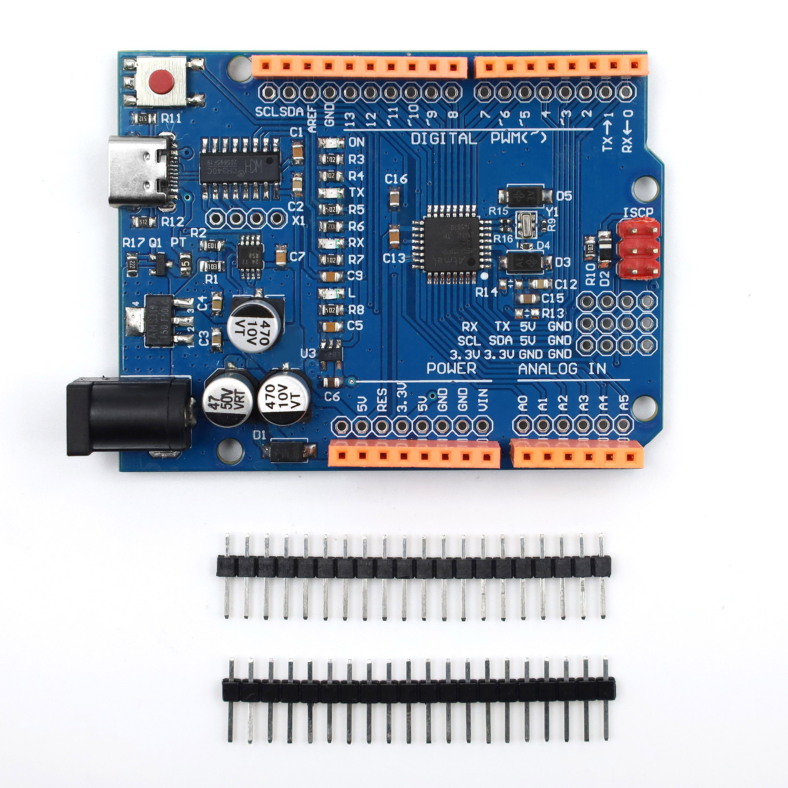

## 概述

  UNO R3 BOARD的处理器核心是ATMEGA328PB-AU，它和官网的ARDUINO UNO REV3完全兼容。它同时具有14路数字输入/输出口（其中6路可作为PWM输出），6路模拟输入，1个16MHz晶体振荡器，1个Type C USB口，1个电源插座，1个ICSP接口和一个复位按钮。

其中ICSP可给ATMEGA328PB-AU烧录固件，由于这个芯片我们在出厂前都以烧录好固件，所有一般不用。使用时我们可以利用USB线供电，利用黑色DC头外部供电（DC 7-12V），还可以利用排母接口Vin GND（DC 7-12V）供电。

## 模块参数

1. 主控芯片：ATMEGA328PB-AU
2. 工作电压：5V
3. 输入电压：DC 7- 12V  （推荐）DC-9V
4. 数字I/0引脚：14 (DO-D13)
5. PWM数字I/0引脚：6 （D3 D5 D6 D9 D10 D11）
6. 模拟输入引脚：6 （A0-A5）
7. 直流电流每I/0引脚：20 MA
8. DC 3.3V电流引脚：50MA
9. 闪存：32 KB （ATMEGA328PB-AU）其中0.5 KB使用的bootloader
10. SRAM:2 KB (ATMEGA328PB-AU)
11. EEPROM: 1 KB （ATMEGA328PB-AU）
12. 时钟速度：16 MHz
13. LED_BUILTIN:D13
14. 开发板尺寸：68.7MM×53.3MM×12MM 
15. 开发板重量：20.5G 
16. 工作温度：0℃~50℃

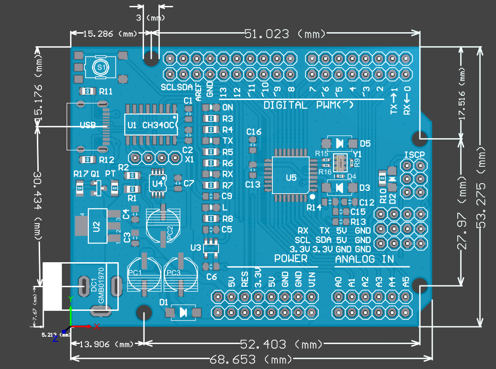

## 产品接口和主要器件说明图例

 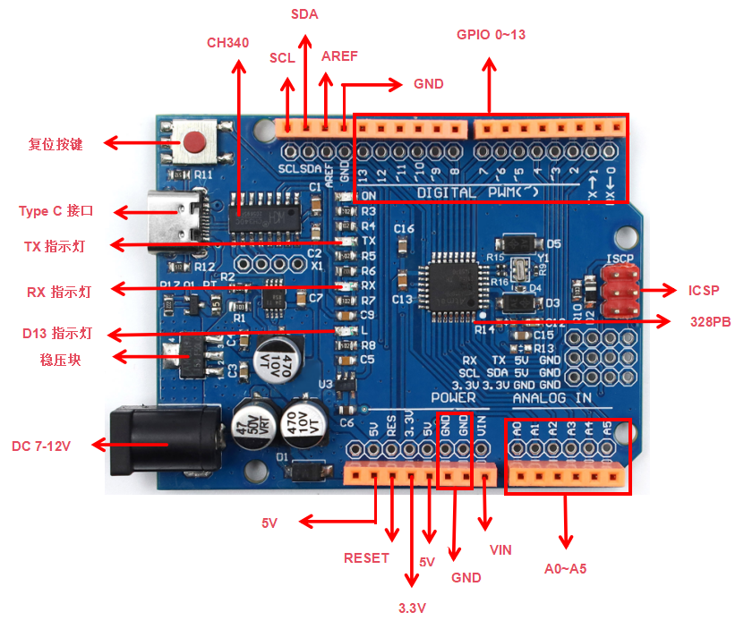

| 1    | ICSP引脚     | 是一个AVR，一个由MOSI，MISO，SCK，RESET，VCC和GND组成的的微型编程头。它通常被称为SPI（串行外设接口），可以被认为是输出的“扩展”。实际上，你是将输出设备从属到SPI总线的主机。连接电脑时，可以给ATMEGA328PB-AU烧录固件。 |
| ---- | ------------ | ------------------------------------------------------------ |
| 2    | 数字I/O      | 有14个数字I/O引脚（D0-D13）（其中6个提供PWM（脉宽调制）输出），这些引脚可配置为数字输入引脚，用于读取逻辑值（0或1） ；或作为数字输出引脚来驱动不同的模块，如LED，继电器等。标有“〜”的引脚可用于产生PWM。 |
| 3    | 地线         | GND                                                          |
| 4    | AREF         | 代表模拟参考。它有时用于设置外部参考电压（0至5伏之间）作为模拟输入引脚的上限。 |
| 5    | SDA          | IIC通信接口 SDA                                              |
| 6    | SCL          | IIC通信接口 SCL                                              |
| 7    | 复位按键     | 可以重置你的控制板                                           |
| 8    | D13指示灯    | 当D13为高电平时，LED亮起，为低电平时，LED熄灭。              |
| 9    | TYPE-C接口   | 接到电脑USB端口，可以给控制板供电，还可以给控制板上传程序。  |
| 10   | 发送指示灯TX | 控制板通过串口通信，发送信息时，TX灯闪烁。                   |
| 11   | 接收指示灯RX | 控制板通过串口通信，接收到信息时，RX灯闪烁。                 |
| 12   | 晶体振荡器   | 它告诉我们，频率是16,000,000赫兹或16MHz。                    |
| 13   | 稳压器       | 它将外部输入的DC  7-12V电压转化成DC 5V电压，然后将DC 5V电压  转送给处理器和其他元件。 |
| 14   | DC7-12V      | 给控制板输入DC  7-12V 外接电源供电。                         |
| 15   | RESET        | 可外接按键，和复位按键功能一样。                             |
| 16   | 3.3V输出     | 提供DC 3.3V 输出电压。                                       |
| 17   | 5V输出       | 提供DC 5V 输出电压。                                         |
| 18   | 模拟引脚     | 6个模拟引脚A0-A5。当数字引脚不够时，也可以当做数字引脚，其中A0相当于D14，A1相当于D15,A2相当于D16,A3相当于D17,A4相当于D18,A5相当于D19。 |
| 19   | 微控制器     | 每个控制板板都有自己的微控制器。你可以假设它作为板的大脑。微控制器通常是ATMEL公司的。在从Arduino IDE加载新程序之前，你必须知道你的板上有什么IC，这个控制板的微控制器是ATMEGA328PB-AU。 |

## 产品特殊接口及功能说明或注意事项

串口通信接口：D0为RX、D1为TX

PWM接口（脉宽调制）：D3 D5 D6 D9 D10 D11

外部中断接口：D2(中断0)和D3 (中断1)

SPI通信接口：D10为SS、D11为MOSI、D12为MISO、D13为SCK

IIC通信端口：A4为SDA、A5为SCL

## 产品使用说明

### 下载安装Arduino IDE(WIN10/MAC)

拿到这个控制板后，我们首先需要下载安装Arduino IDE。

你可以进入以下网址下载Arduino IDE：https://www.arduino.cc/en/software/  进入到这里,根据自己电脑系统选择不同的下载软件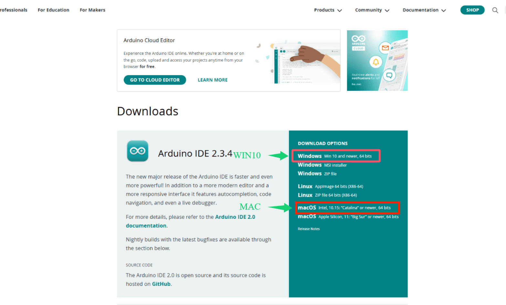

就可以下载最新的2.3.4版本IDE了.如果出现下面了这个界面，就选择，直到他开始下载就可以啦 ，如果没有的话请直接忽略.!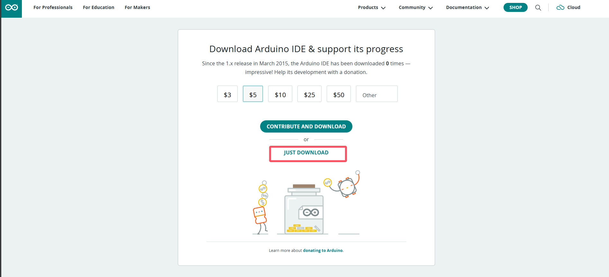

安装过程就很简单了，一直点我同意或者下一步就行了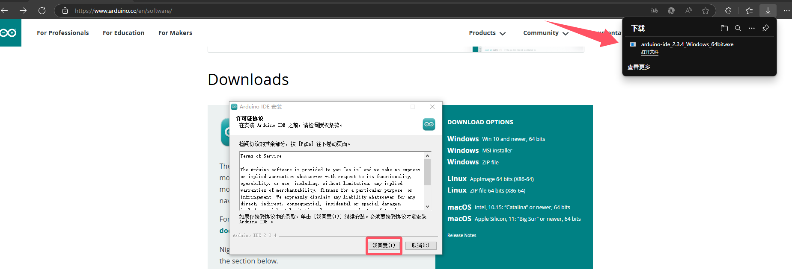

注意，到了这一步的时候我们要记住安装路径，确保自己下次可以找到这个文件,确定没问题就点击安装。

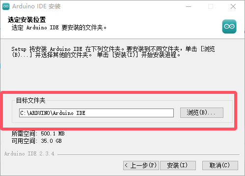

到了这里Arduino IED已经下载安装好啦 。

###  下载USB芯片驱动

接下来就是下载CH340驱动了，，驱动提取链接: https://www.wch.cn/downloads/category/67.html

第一步我们选择和自己板子一样的芯片型号，第二步根据自己的电脑系统选择合适的驱动下载。

 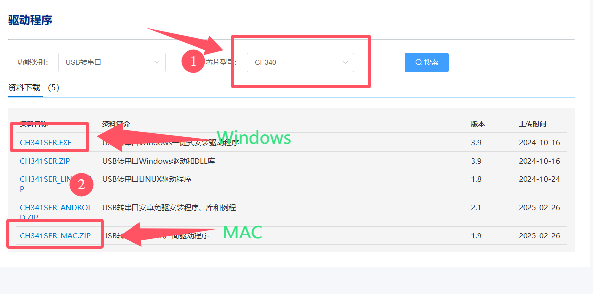

####  WINDOWS版本驱动

选择Windows版本的驱动点击进去后，我们选择下载，随后在右上角找到下载图标，打开下载的文件。

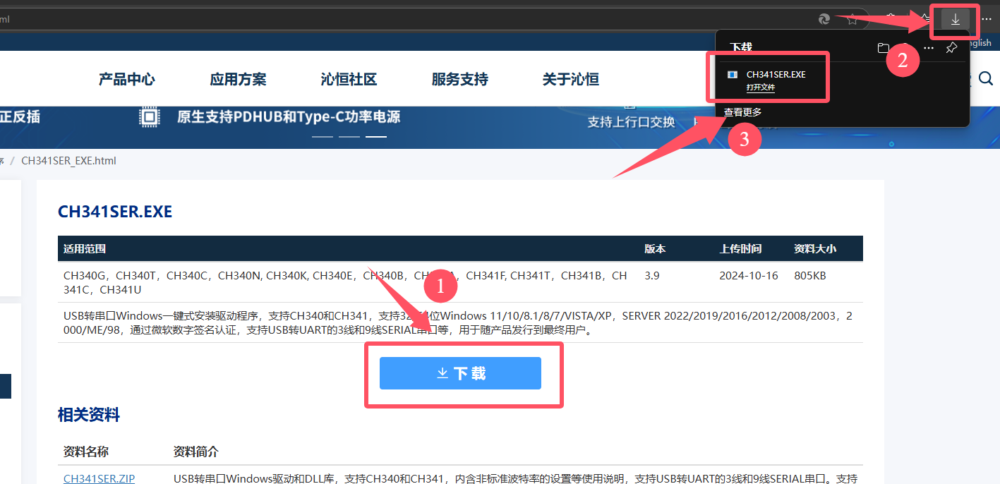

打开文件后我们点击安装就可以。

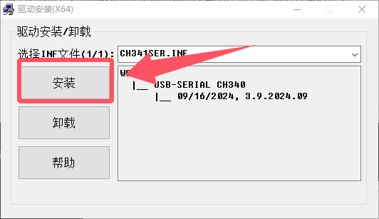

随后我们检查一下驱动安装是否成功，将控制板用USB线连接在电脑上后我们要寻找到设备管理器，在电脑桌面的左下角有个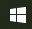，点击之后我们找到此电脑，随后右击鼠标，是右击鼠标哦！选择更多，点击管理。

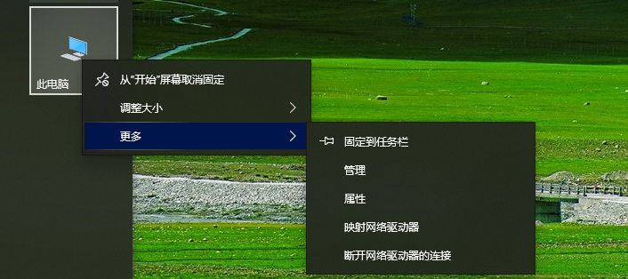

点击之后我们就可以找到设备管理器啦

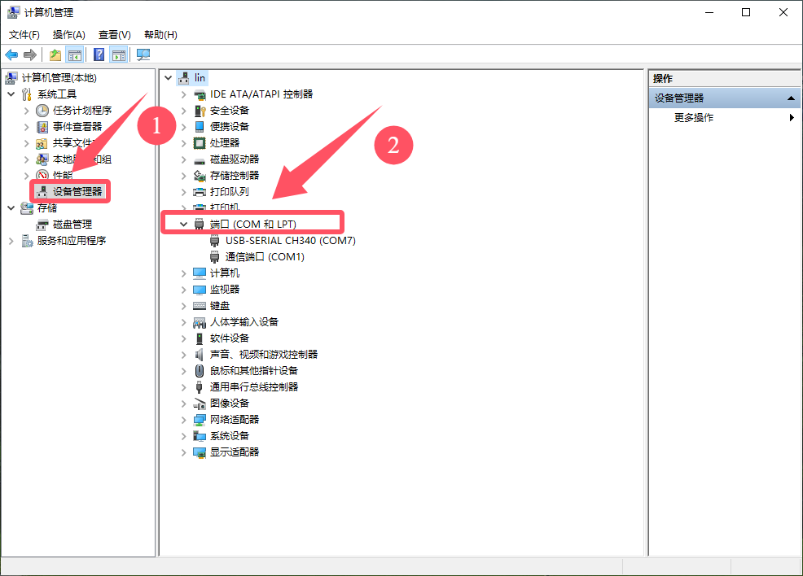

 下图的样子是安装失败的显示，需要重新安装或者换个接口试试，如果成功，请跳过这张。

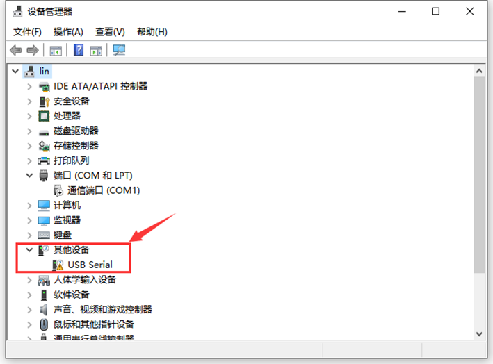

确保设备管理器中显示的端口如图所示就代表安装成功了

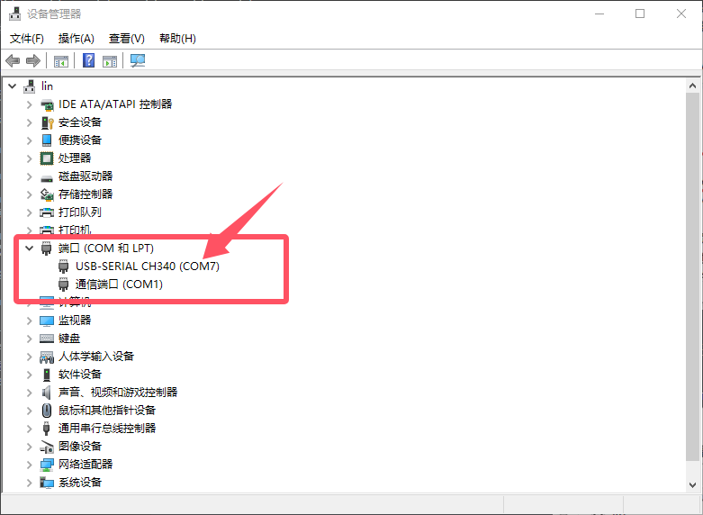

####  MAC版本驱动安装

选择适合MAC的软件下载，进去到其中后我们点击下载，随后在下载栏中找到自己的下载的软件。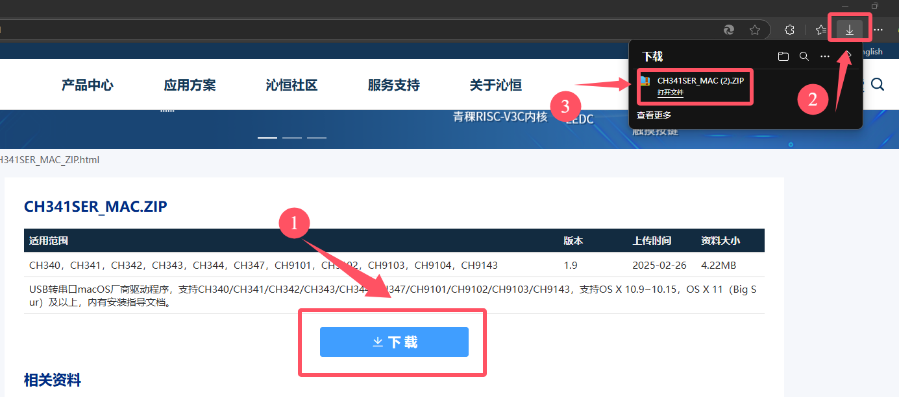

打开安装包后我们就可以获得这三个文件，切记！！三个文件要放在一个文件夹里！！！随后我们点击后缀为PKG的文件进行安装。


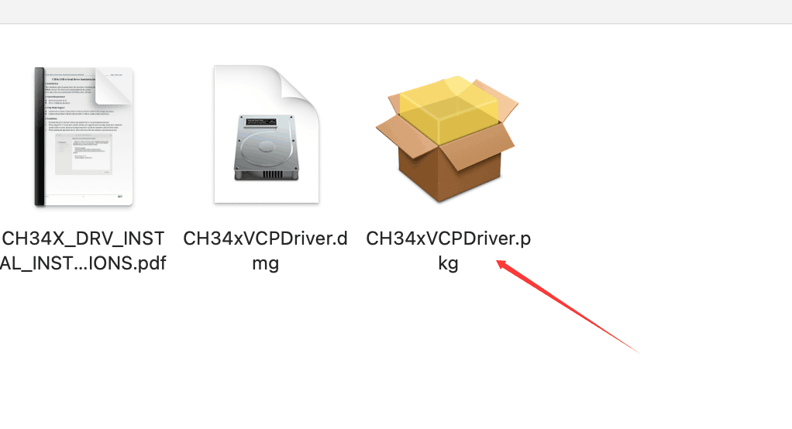

 

接下来还是一样的，继续，下一步，安装三部曲就好啦，不过还是要注意，安装的位置一定要清楚哦。

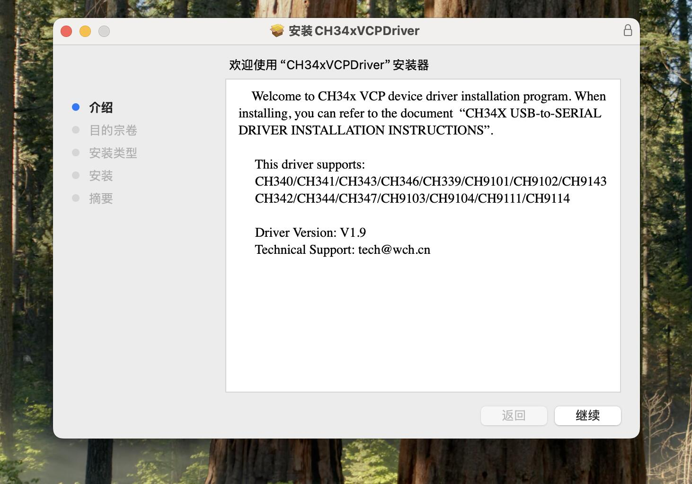

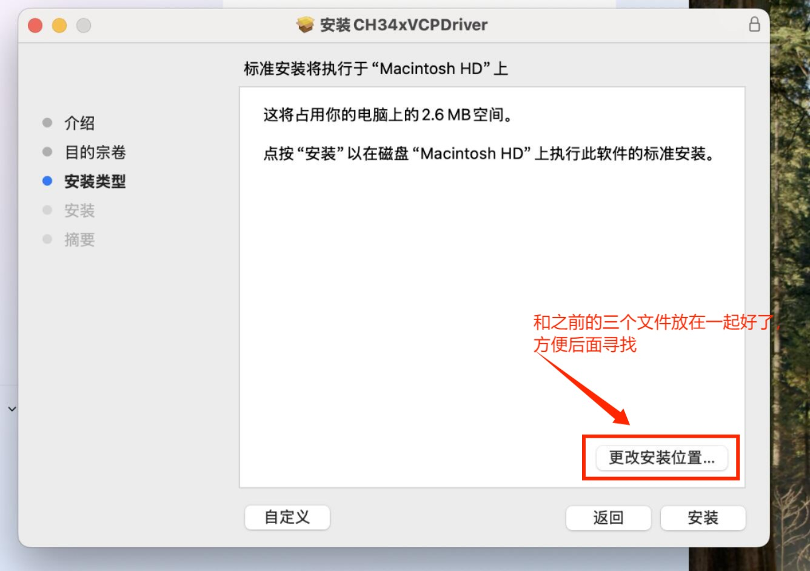


###   Arduino IDE代码烧入

首先我们点击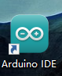图标，打开Arduino IDE，按照图片顺序依次选择我们的开发板和端口（一定要选择正确的开发板和端口哦，不然是无法连接的！！)

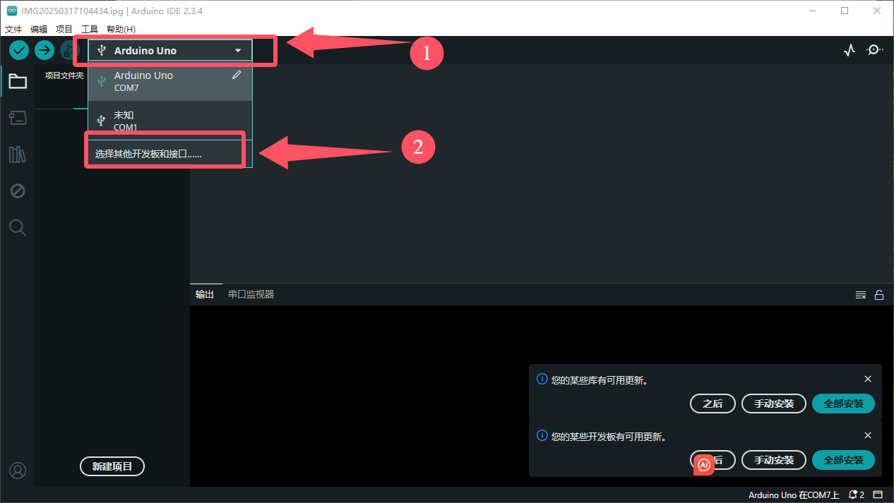

 先输入我们板子的关键字，随后选择正确的开发板，在选择对应的端口，没问题后点击确定。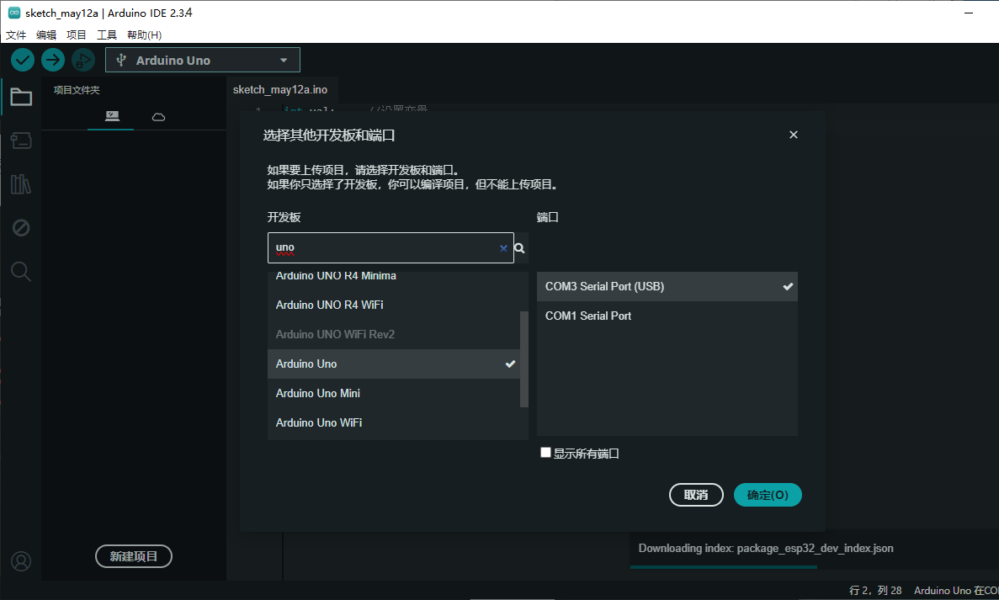

随后我们Ctrl+N或者点击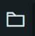后找到新建项目，得到下面界面。

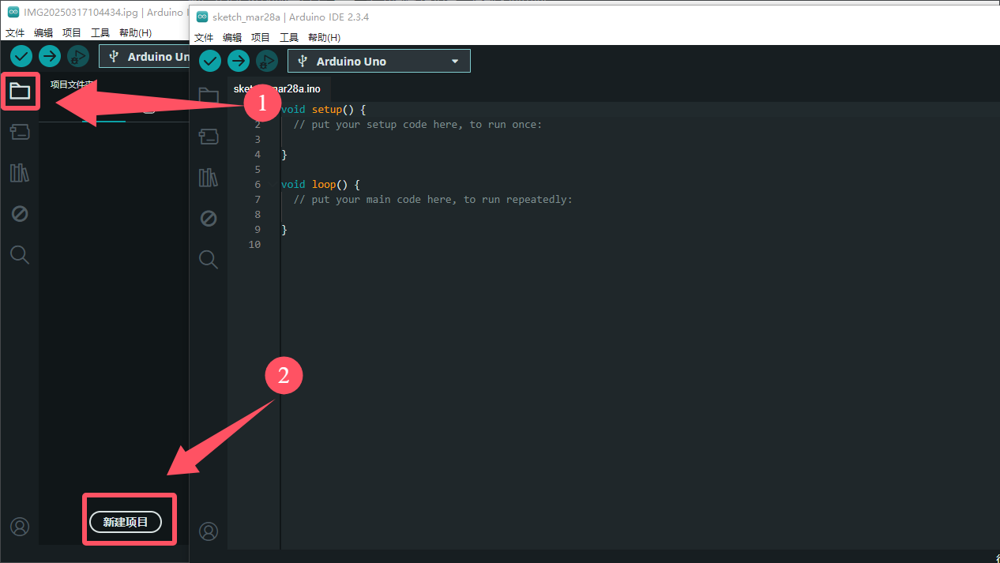

将代码复制进去，注意，一定要将原来的代码全部删除干净哦！

```
int val;           //设置变量
int ledpin = 13;   //设置led引脚为13

void setup()
{
  Serial.begin(9600);        //设置波特率
  pinMode(ledpin, OUTPUT);   //设置引脚模式
}

void loop()
{
  val = Serial.read();    //将串口赋值参数
  if(val == 'R')          //进行串口参数条件判断
	{
	  digitalWrite(ledpin, HIGH);    //灯亮
	  delay(500);       			 //等待500毫秒
	  digitalWrite(ledpin, LOW);     //灯灭
	  delay(500);					 //等待500毫秒
	  Serial.println("Hello World!");   //串口输出Hello World!
	}
}
```

一切没问题之后，我们就要开始编译和烧入程序啦，按照顺序点击  ，出现下面框选的东西（这是代表程序没有问题，要是没有出现下面输出框框内的东西要检查代码是否正确哦)，之后再次点击

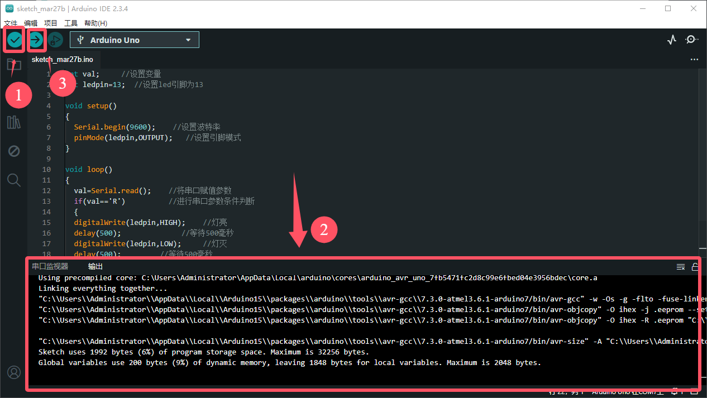

这个时候打开我们的串口监视器，检查波特率是否和我们代码的波特率一致，没问题之后输入R,键盘按Enter，下面窗口就会弹出Hello World!，同时我们的板子灯也会闪烁一下！

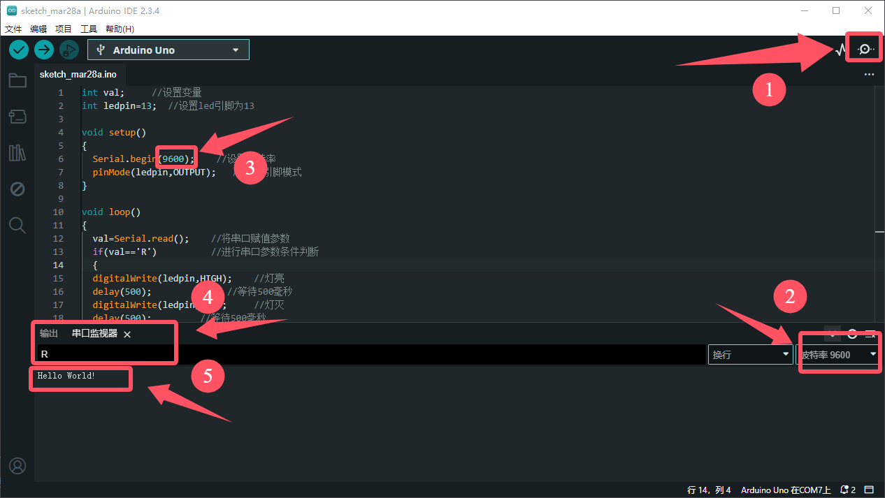

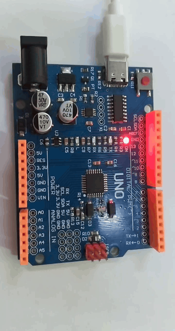

## 常见问题解决方法

### 串口无法连接：

1.需要检查驱动是否安装成功，重新安装CH340驱动.

2.需要看看type-c接口调换一下，或者电脑接口重新拔插一下，再或者换跟数据线试试.

### 产品代码烧入失败

1.检查开发板和端口是否选择正确，重新选择对应端口和开发板.

2.看看代码是否正确，将文本代码复制粘贴进去看看.

3.检查接口是否松动，将接口重新拔插.

4.关闭软件重新打开或者重启电脑.

## 产品重要芯片的规格书下载

 [ATMEGA328PB数据手册](规格书\ATMEGA328PB-AU.pdf) 

 [CH340C数据手册](规格书\CH340C.7z)
